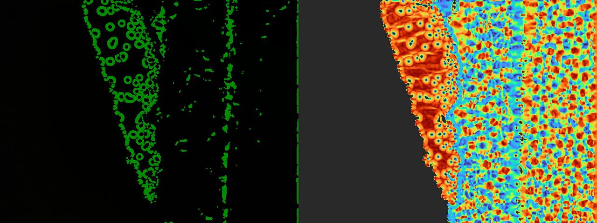
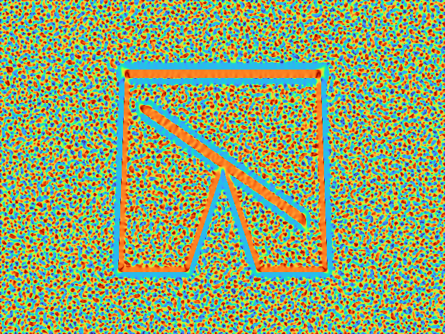
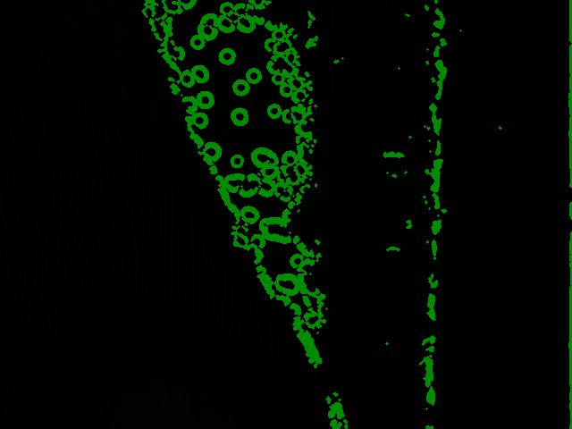

# Differential Geometry & Active Vision for Robotic Clothes Manipulation (Sun et al. 2016)

> **Real-Time 3D Surface Topology, Koenderink Shape Index, and Grasp Ridge Detection**  
> *Reference Paper: Robotic Clothes Manipulation via Active Vision & Differential Geometry (Sun et al., 2016)*  
> *Hardware Validation: Intel RealSense D435 Depth Camera running at 30 FPS over USB 3.2*

---

> [!IMPORTANT]
> **Academic Reproduction & Non-Plagiarism Disclaimer**  
> This repository is an **independent academic reproduction and experimental implementation** created strictly for research, testing, and educational purposes in robotics and artificial intelligence. All foundational theoretical concepts, algorithmic architectures, and task formulations are fully attributed to the original authors (*Sun et al., 2016*). This work does not claim ownership of the original methodology and is published without commercial intent or purpose of plagiarism.

---

## Quick Navigation Index

| Section | Description | Direct Link |
| :--- | :--- | :--- |
| **System Overview** | Continuous 2-manifold surface model and active vision pipeline | [System Overview](#system-overview) |
| **Mathematical Formulation** | Fundamental forms, Gaussian/Mean curvatures, Shape Index, Laplacian | [Mathematical Formulation](#mathematical-formulation) |
| **Hardware & Sensor Specs** | Intel RealSense D435 bus settings, resolution, and noise model | [Hardware & Sensor Specs](#hardware--sensor-specs) |
| **Experimental Results** | Live thermal colormaps, ridge segmentation, and edge overlays | [Experimental Results](#experimental-results) |
| **Repository Structure** | Codebase layout and document organization | [Repository Structure](#repository-structure) |
| **Execution Guide** | How to run live streaming or the synthetic benchmark | [Execution Guide](#execution-guide) |

---

## System Overview

Robotic textile manipulation requires grasping flexible fabrics without relying on rigid planar assumptions. This repository implements the differential geometry framework proposed by **Sun et al. (2016)**, treating depth point clouds as continuous 2-manifold surfaces embedded in $\mathbb{R}^3$.

```
+-----------------------------------+
| Intel RealSense D435 Depth Stream | (848x480 @ 30 FPS, USB 3.2)
+-----------------+-----------------+
                  |
                  v
       [ Bilateral Noise Filter ]     (Spatial sigma=3.0, Range sigma=0.03m)
                  |
                  v
    [ Partial Derivatives Matrix ]    (fx, fy, fxx, fyy, fxy via Sobel/Scharr)
                  |
                  v
    [ 1st & 2nd Fundamental Forms ]   (E, F, G and L, M, N)
                  |
                  v
  [ Gaussian (K) & Mean (H) Curv. ]   (Principal curvatures kappa_1, kappa_2)
                  |
                  v
    [ Koenderink Shape Index S ]      (In [-1, +1] scale-invariant topology)
                  |
                  v
   [ Laplacian Zero-Crossing Det. ]   (nabla^2 Z = 0 + ridge extraction)
                  |
                  v
    [ Dual-Window Real-Time GUI ]     (RGB + Ridge Overlay | Thermal Shape Index)
```

### Visual Highlights

| Live Ridge Detection (RealSense D435) | Full Differential Geometry Pipeline |
| :---: | :---: |
|  |  |

| Bilateral Noise-Resistant Filter | Grasp Ridge Contour Overlay |
| :---: | :---: |
|  |  |

---

## Mathematical Formulation

### 1. First and Second Fundamental Forms
Locally modeling the cloth surface as Monge patch $Z = f(X, Y)$, we compute first and second order spatial gradients $(f_x, f_y, f_{xx}, f_{yy}, f_{xy})$:

* **First Fundamental Form Coefficients:**
  $$E = 1 + f_x^2, \quad F = f_x f_y, \quad G = 1 + f_y^2$$

* **Second Fundamental Form Coefficients:**
  $$L = \frac{f_{xx}}{\sqrt{1 + f_x^2 + f_y^2}}, \quad M = \frac{f_{xy}}{\sqrt{1 + f_x^2 + f_y^2}}, \quad N = \frac{f_{yy}}{\sqrt{1 + f_x^2 + f_y^2}}$$

### 2. Gaussian, Mean, and Principal Curvatures
From the fundamental forms, the intrinsic Gaussian curvature $K$ and extrinsic Mean curvature $H$ are derived:
$$K = \frac{LN - M^2}{EG - F^2}, \quad H = \frac{EN - 2FM + GL}{2(EG - F^2)}$$
The two principal curvatures $\kappa_1$ and $\kappa_2$ (with $\kappa_1 \ge \kappa_2$) are the eigenvalues of the shape operator:
$$\kappa_1 = H + \sqrt{\max(0, H^2 - K)}, \quad \kappa_2 = H - \sqrt{\max(0, H^2 - K)}$$

### 3. Koenderink Shape Index ($S$) and Curvedness ($C$)
The Shape Index maps local topological structures into a scale-invariant interval $S \in [-1, 1]$:
$$S = \frac{2}{\pi} \arctan \left( \frac{\kappa_1 + \kappa_2}{\kappa_1 - \kappa_2} \right), \quad C = \sqrt{\frac{\kappa_1^2 + \kappa_2^2}{2}}$$

* **Convex Ridges / Pliegues ($S \in [0.125, 0.375]$):** Elevated cloth folds, primary targets for robot gripper pinch.
* **Saddle Points / Sillas ($S \approx 0.0$):** Multi-directional bend areas.
* **Concave Troughs / Valles ($S \in [-0.375, -0.125]$):** Folds receding into the tabletop.

### 4. Laplacian Zero-Crossing for Ridge Boundary
Wrinkles and ridge centerlines satisfy zero crossings of the Laplacian operator:
$$\nabla^2 Z(u, v) = \frac{\partial^2 Z}{\partial u^2} + \frac{\partial^2 Z}{\partial v^2} = 0$$
gated by the curvature threshold $\kappa_1 \ge \kappa_{\text{threshold}}$ and minimum curvedness $C > C_{\text{min}}$.

---

## Hardware & Sensor Specs

* **Depth Camera:** Intel RealSense D435 (Stereo IR + Active Projector).
* **Connection Bus:** High-Speed **USB 3.2 Gen 1** (verified via `pyrealsense2`).
* **Frame Rate:** 30 FPS at $848 \times 480$ (depth) and $1280 \times 720$ (color).
* **Depth Accuracy / Noise Profile:** Realistic depth noise is modeled as quadratic with distance:
  $$\sigma_z(Z) = \frac{Z^2 \cdot \text{Subpixel Err}}{f \cdot B}$$
  mitigated by spatial bilateral smoothing before derivative calculation.

---

## Repository Structure

```text
sun2016_active_vision/
├── .gitignore
├── README.md                                 <- Master documentation
├── docs/
│   ├── Sun_ActiveVisionClothesManipulation_2016.pdf <- Original scientific paper
│   └── images/                               <- Experimental captures and overlays
└── src/
    ├── sun_geometry.py                       <- Vectorized NumPy differential geometry engine
    ├── live_realsense_sun.py                 <- 30 FPS multithreaded RealSense streaming GUI
    └── d435_noise.py                         <- Quadratic depth noise simulator
```

---

## Execution Guide

### 1. Installation
Install core requirements:
```bash
pip install numpy scipy opencv-python pyrealsense2
```

### 2. Live Camera Mode (Requires RealSense D435)
Connect the Intel RealSense D435 camera to a USB 3.0/3.2 port and run:
```bash
python src/live_realsense_sun.py
```
* **Keys:**
  * `q` / `ESC`: Exit viewer.
  * `s`: Save snapshot of current RGB, depth, thermal Shape Index, and detected ridges.

### 3. Standalone Verification (No Camera Required)
If running on a workstation without physical camera hardware, `sun_geometry.py` includes a self-contained unit test with synthetic wrinkled surfaces:
```bash
python src/sun_geometry.py
```
Outputs validation matrices and confirms absence of numerical singularities ($\epsilon = 10^{-7}$).

---

## References

* Sun, L., Aragones, G. A., & Rogers, S. (2016). *Robotic Clothes Manipulation via Active Vision & Differential Geometry*.
* Koenderink, J. J., & van Doorn, A. J. (1992). *Surface shape and curvature scales*. Image and Vision Computing.
